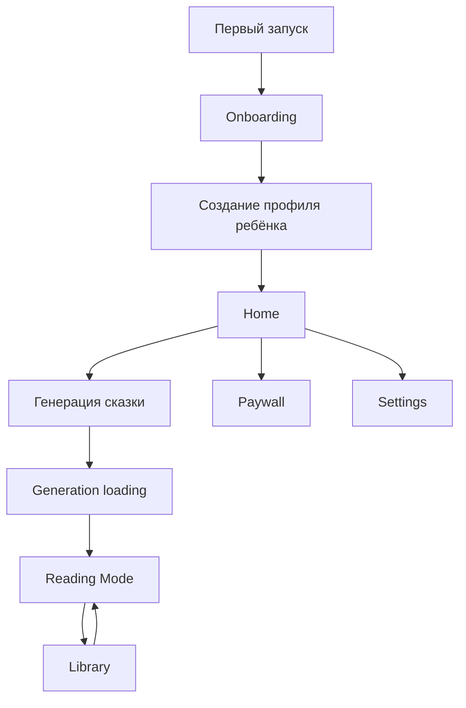

# UI Flow — Bedtime Stories AI

**Версия:** 0.1  
**Статус:** Draft  
**Платформа MVP:** iPhone, portrait. iPad — следующий этап (то же приложение, адаптивная раскладка). Референс экранов: прототип Claude Design, раздел 7

---

## 1. Цель UI MVP

Пользователь должен за 2–3 минуты пройти путь:

1. Понять ценность приложения.
2. Создать профиль ребёнка.
3. Сгенерировать первую сказку.
4. Прочитать её в спокойном bedtime-интерфейсе.
5. Понять, какие возможности открываются подпиской.

MVP UI должен быть мягким, понятным для родителя вечером, без перегрузки настройками.

---

## 2. Основной User Journey

---

## 3. Экраны MVP

### 3.1 Onboarding

**Цель:** объяснить пользу до запроса разрешений, paywall и аналитики.

**Слайды:**
- “Персональные сказки на ночь” — имя, возраст, интересы ребёнка.
- “Мягкий и безопасный контент” — без страшных и жестоких элементов.
- “Истории сохраняются в библиотеке” — можно читать офлайн.

**Основные действия:**
- `Начать`
- `Уже есть аккаунт? Войти с Apple`

**События аналитики:**
- `onboarding_started`
- `onboarding_completed`

---

### 3.2 Создание профиля ребёнка

**Цель:** собрать минимальные данные для первой качественной сказки.

**Поля MVP:**
- Имя ребёнка
- Возраст
- Язык сказки
- Интересы: multi-select chips
- Любимый мир/жанр
- Любимый персонаж, опционально

**UX-правила:**
- Не показывать слишком много полей сразу.
- Использовать подсказки-примеры: “динозавры”, “космос”, “волшебный лес”.
- После сохранения сразу вести на Home.

**Paywall-точка:**
- Free: максимум 1 профиль.
- При попытке добавить второй профиль показывается paywall.

**События:**
- `profile_created`
- `paywall_viewed` при превышении лимита профилей

---

### 3.3 Home

**Цель:** главный экран “что читаем сегодня?”.

**Блоки:**
- Активный профиль ребёнка.
- Primary CTA: `Сгенерировать сказку на ночь`.
- Быстрые параметры: формат, длина, настроение, интересы.
- Последняя история / продолжить чтение.
- Story Arc teaser: “Серия на 7 вечеров”.

**Primary CTA behavior:**
- Если лимит доступен — запуск генерации.
- Если лимит исчерпан — paywall.
- Если нет профиля — переход к созданию профиля.

**События:**
- `story_generate_started`
- `paywall_viewed`

---

### 3.4 Экран генерации

**Цель:** показать прогресс и снизить тревожность ожидания.

**Состояния:**
- `queued`: “Готовим идею сказки...”
- `generating_text`: “Пишем добрую историю...”
- `safety_check`: “Проверяем, что всё подходит ребёнку...”
- `generating_images`: “Рисуем иллюстрации...” (когда включены изображения)
- `completed`: переход в Reading Mode
- `failed`: понятная ошибка и retry

**MVP:** генерация синхронная (запрос висит 25–35 с), шаги экрана идут по таймеру, пока ждём ответ; быстрый ответ всё равно проходит оставшиеся шаги. Следующая часть серии использует тот же экран. Ошибки: 402 открывает пейволл (для лимита серий текст «Серия уже идёт», для Free «Это есть в подписке»), 409 «часть уже готова» / «герои удалены» объясняются человеческим текстом, нет сети и ответы сервера дают повтор.

**События:**
- `story_generate_completed`
- `story_generate_failed`

---

### 3.5 Reading Mode

**Цель:** спокойное чтение перед сном.

**Основные элементы:**
- Название сказки.
- Текст крупным шрифтом.
- Inline-иллюстрации, когда доступны.
- Нижняя панель: bookmark, font size, theme, play audio.
- Мораль/заключение визуально отделяется.

**Режимы:**
- Light
- Dark
- Nightlight: минимальная яркость, тёплые цвета

**Чтение вслух (сделано):**
- Кнопка с наушниками в верхней панели (рядом сердечко и «Аа»); при чтении значок меняется на динамик
- Плеер внизу: назад / пауза / вперёд (абзац для голоса устройства, 15 секунд для премиум-голоса), переключатель голоса, скорость, таймер сна, закрыть
- Голос устройства: читаемый абзац подсвечен, остальные приглушены, текст прокручивается за голосом
- Премиум-голос (Family+): при первом запуске «Готовим голос… это займёт около минуты», потом играет файл; повторный запуск мгновенный. Если премиум-голос не получился или тариф его не включает, читает голос устройства и над плеером появляется короткая подсказка. На Free и Family пункт «Премиум-голос · Family+» виден, но выбрать его нельзя
- Чтение идёт при заблокированном экране, на экране блокировки есть play/pause
- Уход с экрана останавливает чтение

**Video future:**
- Видео-сцены не автозапускаются.
- Родитель явно нажимает play.
- Видео не должно мешать bedtime-настроению.

**События:**
- `story_read_started`
- `story_read_completed`

---

**Читалка серии:** под названием «Часть N из M · название серии»; в конце части карточка «Часть N из M прочитана» с кнопкой «К серии», у последней части «Серия закончена»; мораль показывается только у последней части. Дочитывание части отправляет `readPart`.

---

### 3.6 Library

**Цель:** быстро найти и перечитать сохранённые истории.

**Блоки:**
- Фильтр по ребёнку.
- Фильтр по формату: Quick Story, Classic, Story Arc.
- Избранное.
- Истории по дате.
- Download/offline indicator.

**Empty state:**
- “Здесь появятся ваши сказки.”
- CTA: `Создать первую сказку`

---

### 3.6a Создание серии и экран серии

**Сочинить:** переключатель «Одна сказка / Серия»; у серии чипы «3 части / 5 частей / 7 частей» и подпись «Одна часть на вечер. Первую напишем сейчас…». Кнопка меняется на «Начать серию». После генерации обложка подписана «Готово · новая серия» и «Серия · N частей», потом чтение части 1.

**Экран серии** (открывается из «Сказок» и «Сегодня», у карточек серии подпись «Серия · 2 из 7»): обложка, название, строка «Написано 2 из 7 · прочитано 1», сегментный прогресс, список написанных частей («Прочитана» / «Новая», нажатие открывает часть). Одна главная кнопка: «Читать часть N» (если есть непрочитанная; под ней «Сочинить часть N+1 сейчас»), иначе «Сочинить часть N+1»; у законченной серии подпись «Серия закончена. Любую часть можно перечитать».

---

### 3.7 Paywall

**Цель:** объяснить ценность подписки в момент потребности.

**Точки входа:**
- Лимит Free исчерпан.
- Story Arc на Free.
- Второй профиль ребёнка.
- HD-изображения.
- Premium voices.
- Future video add-on.

**Структура paywall:**
- Заголовок, связанный с действием пользователя.
- 3–4 bullet benefits.
- Переключатель тарифа Family | Family+ (при отказе по премиум-голосу открывается сразу Family+) и список тарифов год / месяц с ценами из StoreKit, «Выгода N%» у годового.
- CTA: `Оформить подписку` (бесплатные 7 дней у нас уже идут с первого запуска, поэтому кнопки «Попробовать» нет); под ней условия автопродления.
- Secondary: `Продолжить пробный период` (пока идёт триал) или `Продолжить с Free`
- Ошибки и ожидание (Ask to Buy, не удалось подтвердить оплату) показываются строкой над кнопкой; если тарифы не загрузились, «Повторить».
- Footer: restore purchases, terms, privacy.

**Важно:** paywall не блокирует чтение уже созданных историй.

**События:**
- `paywall_viewed`
- `trial_started`
- `subscription_started`

---

### 3.8 Settings

**Разделы:**
- Профили детей.
- Подписка и restore purchases.
- Напоминания.
- Privacy и analytics consent.
- Язык.
- Help / feedback.

**Privacy:**
- Родитель может отключить analytics/personalization.
- Объяснить, что имена детей и тексты сказок не отправляются в аналитику.

---

## 4. Навигационная Модель

MVP использует `TabView`:

| Tab | Назначение |
|---|---|
| Home | Генерация и продолжение чтения |
| Library | Сохранённые истории |
| Settings | Профили, подписка, privacy |

Onboarding и paywall открываются модально поверх основной навигации. Reading Mode открывается как full-screen detail, чтобы убрать визуальный шум.

---

## 5. Состояния, Которые Нельзя Забыть

| Сценарий | UI state |
|---|---|
| Нет интернета | Показать offline mode и доступные сохранённые истории |
| API generation failed | Retry, смена параметров, понятное сообщение |
| Подписка истекла | Downgrade notice без блокировки библиотеки |
| Нет профиля | Empty state с CTA на создание профиля |
| Нет историй | Empty library state |
| Медиа ещё генерируются | Story доступна как текст, медиа догружаются позже |

---

## 6. MVP Scope

**Сделано (ноябрь 2026):**
- Onboarding, Profile creation (с внешностью), редактирование и удаление детей
- Home, Library (поиск, избранное, прогресс, офлайн-кэш)
- Генерация и Reading Mode с иллюстрациями, моралью и финальной фразой
- Экран «Сочинить» (герои, формат, тема, мир, длина)
- Серии (создание, экран серии, чтение частей)
- Чтение вслух: голос устройства и премиум-голос
- Paywall с покупкой и restore (StoreKit 2)

**Не сделано:**
- Settings (в том числе «Управление подпиской»)
- Push, iCloud, экспорт PDF, закладка, светлая тема и «ночник»
- Видео
- Полноценные paywall experiments, AppsFlyer dashboards

---

## 7. Прототип Claude Design (iPhone) и расхождения с документами

Интерактивный прототип экранов сделан в Claude Design: <https://claude.ai/artifact/TFiMsHvPvCUiABV13RDKus>. Исходники экранов лежат в `docs/design/prototype/` (React-прототип: `app.jsx` — машина состояний, `screens-*.jsx` — экраны, `ui.jsx` — атомы и аватар героя, `styles.css` — токены ночной палитры и компоненты). Это референс для SwiftUI, не продуктовый код.

**Что в прототипе.** Онбординг: приветствие → 3 слайда ценности → имя → возраст (2–12) → внешность (пол, оттенок кожи, цвет и длина волос, цвет одежды) → интересы (16 штук) → мир (6 штук) → генерация → обложка → чтение → пейволл → готово. Основное приложение: вкладки «Сегодня», «Сказки», «Сочинить», «Дети». Экран «Сочинить»: для кого (можно несколько детей), тема (6 готовых или своими словами), мир, длина (~4 / ~7 / ~12 мин), режим (читаю сам / слушаем / оба), голос рассказчика. Чтение: заголовок, абзацы, иллюстрация inline, «Мораль сказки», финальная фраза.

**Расхождения, которые нужно закрыть:**

| Тема | Прототип | Документы / бэкенд | Статус |
|---|---|---|---|
| Устройство | iPhone, 402×874 | PRD, UI_Flow, Design_System: iPad primary | **Решено: iPhone-first, iPad позже.** Документы приведены к iPhone, размеры iPad остаются как цель следующего этапа |
| Аккаунт | Онбординг и первая сказка без входа, «Уже есть аккаунт? Войти с Apple» | Генерация требовала Apple Sign In | Закрыто в бэкенде: `POST /v1/auth/anonymous`, привязка Apple ID к гостю |
| Внешность героя | Кожа, волосы, длина волос, одежда, пол (мальчик / девочка / не указывать) | Только имя, возраст, интересы, мир | Закрыто в бэкенде: `appearance` и `gender` в профиле, описание героя идёт в промпты текста и картинок |
| Мир | 6 миров с id (`forest`, `ocean`, `space`, `castle`, `clouds`, `jungle`) | Свободные строки | Закрыто в бэкенде: `WORLD_IDS` в `packages/shared`, валидация |
| Создание сказки | Тема, длина в минутах, несколько героев сразу, мир на сказку | Только формат и `wordCount` | Закрыто в бэкенде: `topic`, `lengthMinutes`, `profileIds[]`, `world` |
| Структура сказки | Название, абзацы, «Мораль сказки», финальная фраза, «≈ 5 мин чтения», «3 иллюстрации» | Один markdown-текст | Закрыто в бэкенде: поля `moral`, `closing`, `readingMinutes` |
| Библиотека | Избранное, прогресс чтения, мир, группировка по дате | Нет | Закрыто в бэкенде: `favorite`, `readProgress`, `world`, `heroIds` (`PATCH /v1/stories/:id`). Группировка по дате считается на клиенте по `createdAt` |
| Аудио | Режим «слушаем» и 3 голоса на экране «Сочинить» | PRD: TTS это v2 | **Решено: аудио в v1, но в читалке**, а не на «Сочинить»: кнопка с наушниками, голос устройства (всем) и премиум-голос (Family+). Режимов «читаю сам / слушаем / оба» и выбора из трёх голосов на «Сочинить» нет |
| Пейволл | Только Family (год 49 990 ₽, месяц 699 ₽), кнопка «Попробовать 7 дней бесплатно», «Восстановить» | PRD: Family $49.99 / $6.99, Family+, триал 7 дней при первой установке без карты | **Решено**: Family+ показываем переключателем; триал серверный без карты, кнопка «Попробовать» заменена на «Оформить подписку»; цены берутся из StoreKit. **Открыто**: цены и валюта в App Store Connect |
| Экран генерации | 5 шагов: идея, текст, проверка безопасности, иллюстрации, сохранение | Синхронный запрос без прогресса | Совпадает с шагами пайплайна; в прототипе шаги идут по таймеру, реальный прогресс потребует job-API (см. BullMQ в роадмапе) |
